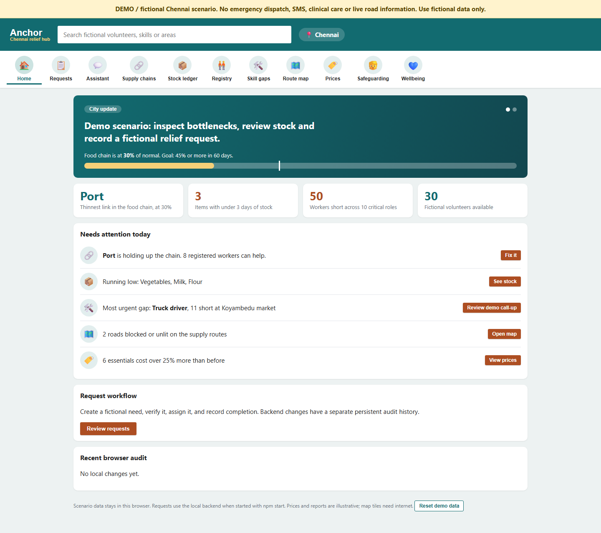
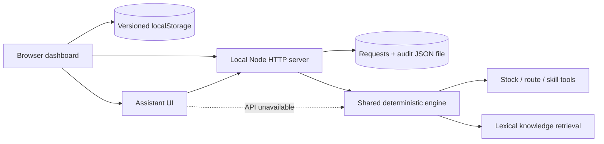

# Anchor | Chennai relief coordination demo

[GitHub repository](https://github.com/VikramGit123dotcom/ANCHOR-Product)

Anchor connects a simple question - **what is limiting relief delivery, and what can a coordinator review next?** - to supply-chain bottlenecks, stock cover, fictional volunteer availability and a request lifecycle.

This is an **AI-assisted portfolio prototype**, prepared from the supplied single-file Anchor dashboard for a conversational-AI engineering application. All scenario records are fictional. The assistant is a deterministic, inspectable tool-and-retrieval demo; **there is no connected LLM or Edgechat deployment**.



## Run locally

Install Node.js 20 or newer, then open a terminal in this folder:

```sh
npm start
```

Open **http://127.0.0.1:3000**. No package installation, API key or database service is required. Stop with Ctrl+C.

Optional port override:

```powershell
$env:PORT = '3001'
npm start
```

The server uses Node built-ins and binds to loopback. `.env.example` is reference documentation; `.env` files are not automatically loaded.

```sh
npm test
npm run eval
```

Tests cover route freshness/ranking, stock math, dashboard rendering, validation, request persistence, audit history and conflicting updates. Evaluations write measured results to `evals/RESULTS.md` and `evals/results.json`. The current run is included; these authored cases are regression checks, not a claim of production safety or general language understanding.

## Review in five minutes

1. **Home / Supply chains:** inspect the food-chain bottleneck and simulated crew changes.
2. **Stock ledger:** compare quantity, daily consumption and stock-cover assumptions.
3. **Requests:** create “Demo water delivery”; move it through verified, assigned, in_progress and completed. Reload to confirm persistence.
4. **Assistant:** ask “water stock”, “route”, “skill gaps” and “how to register”. Expand each tool trace. Try “தண்ணீர் இருப்பு” or “volunteer பதிவு”.
5. Ask for child details or an unsupported fact. Inspect the refusal/uncertainty response, then read the limitations and evaluation cases.

## Implemented versus simulated

| Capability | Actual behavior |
|---|---|
| Bottleneck analysis | Minimum available/required crew ratio across a selected chain; illustrative capacity proxy |
| Inventory | Browser-persisted stock and quantity / daily-use cover calculation |
| Volunteer registry | Fictional browser records and demo status changes; no identity or credential checks |
| Request API | Real local HTTP endpoints, JSON-file persistence, sequential writes, version conflicts and structured audit events |
| Assistant tools | Real read-only JavaScript functions over the supplied fictional browser snapshot |
| Retrieval | Keyword-ranked local documents with source IDs; no embeddings, vector store or generative model |
| Tamil / English | Hand-authored responses for documented Tamil intents; not general bilingual fluency |
| Short mode | Caps reply at 160 Unicode code points; Tamil encoding may need multiple SMS segments |
| Browser fallback | Same assistant engine without the API; no offline write queue or background sync |
| Route candidates | Fresh clear fictional reports only; never real navigation or live road confirmation |
| Call-ups / assignments | Local scenario changes; no SMS, team dispatch or volunteer acceptance |
| Safeguarding / support | Information-only boundary; no child matching, patient records or care booking |
| Maps | Leaflet/CDN and third-party imagery; internet required, no offline tile cache |

## Structure

```text
anchor/
  app/                 Static frontend
    index.html
    css/styles.css
    js/app.js          Original dashboard split from the supplied HTML
    js/core.js         Shared stock/route rules
    js/enhancements.js Safer demo views, requests and chat UI
    js/assistant-engine.js
    js/kb.js           Browser mirror of kb/relief-guide.json
  backend/server.js    Local HTTP API and static-file server
  data/                Runtime request store (ignored by Git)
  prompts/             Versioned assistant behavior contract
  kb/                  Reviewed local knowledge-base records
  evals/               42 authored cases, runner and measured results
  tests/               Built-in Node test suite
  docs/                Architecture, API, demo guide, write-up, screenshot
  .github/workflows/   CI and optional manual GitHub Pages deployment
  .env.example
  package.json
  LICENSE
```

## Architecture



The browser passes public scenario data to the chat endpoint. These are untrusted, fictional inputs, not verified operational records. Requests live separately in the local backend; the chat does not mutate them or allocate stock. See [architecture](docs/ARCHITECTURE.md) and [API reference](docs/API.md).

## Conversational-AI relevance

The project demonstrates intent routing, a tool interface, source-grounded retrieval, explicit unsupported-answer behavior, prompt/behavior versioning, short replies, a local fallback and reproducible evaluation. It is a base for an LLM integration, not a claim to have implemented model-driven function calling or production RAG. The behavior specification in `prompts/system-v1.md` documents rules implemented in code; it is not an active model prompt.

The weakest-link model highlights why uneven capacity matters. It does **not** establish that a random 50% workforce loss always produces 30% flow. In this seed, the minimum food-chain staffing ratio is 12/40 = 30%; this is scenario arithmetic, not an empirical finding or logistics forecast.

## Data and operational limits

- Use fictional data only. There is no login, role enforcement, shared database, encryption at rest or tamper-proof audit service. The actor is `local-demo-user`.
- The loopback server rejects foreign origins and unexpected Host headers; this does not make it suitable for public deployment. It has no production rate limiting, access control or robust cross-process locking.
- Only requests and their audit events persist on the server. Scenario changes remain per-browser. Reset demo data resets that browser scenario; it does not erase server requests. To reset server requests, stop the server and remove `data/requests.json`.
- Route report timestamps start at a fixed fictional scenario time. They become stale in real time. Editing a route simulates a new report, not an independently verified observation.
- Browser audit history is capped at 300 events. Server audit entries share the same JSON file as requests and are locally editable.
- Retrieval is limited to the small authored guide. Keyword rules can miss paraphrases and can misclassify adversarial or crisis messages. No safety certification is implied.
- Third-party fonts, Leaflet and map imagery need internet and have their own terms/attributions. The core dashboard can function when those resources fail.

## GitHub and submission

The project source is maintained at [https://github.com/VikramGit123dotcom/ANCHOR-Product](https://github.com/VikramGit123dotcom/ANCHOR-Product). Do not commit `.env`, private records or runtime `data/requests.json`.

To clone and run this repository:

```sh
git clone https://github.com/VikramGit123dotcom/ANCHOR-Product.git
cd ANCHOR-Product
npm start
```

Confirm that the repository is public or explicitly invite the reviewer. No hosted app or Edgechat deployment is claimed.

For an optional **frontend-only** demo, set GitHub Pages source to GitHub Actions and manually run the included Pages workflow. The assistant falls back to browser mode. The Requests backend does not run on GitHub Pages; use `npm start` locally for the complete review. The workflow publishes only `app/`.

Submit the repository link for the creation question, and `docs/Anchor-Writeup.pdf` for the write-up question. The PDF includes this repository URL. Review the first-person write-up and add your own motivation or name if desired. See [submission checklist](docs/SUBMISSION.md).

## Roadmap

1. Integrate an LLM through a server-side provider adapter; validate structured tool arguments and compare against the deterministic baseline.
2. Add embedding retrieval only if it improves a held-out bilingual evaluation set; keep source provenance and refusal behavior.
3. Add authenticated roles, consent, PostgreSQL transactions and independently verifiable event history before multi-user use.
4. Add a confirmed notification provider with delivery callbacks and opt-in. No provider is configured here.
5. Design offline request queues with conflict review, then evaluate road-network routing with authoritative incident sources.
6. Evaluate on the employer's platform after its capabilities and access have been confirmed. No Edgechat integration is claimed.

## Provenance and license

The supplied `anchor-chennai (3).html` was the source dashboard. This package extracts its frontend and adds code and documentation with AI assistance. No claims about the user's prior development process, field testing or deployment are invented. See `docs/PROVENANCE.md`. This package uses the MIT license for project code; confirm that you have rights to license the original before publishing. Third-party map/font/library rights remain with their owners.
